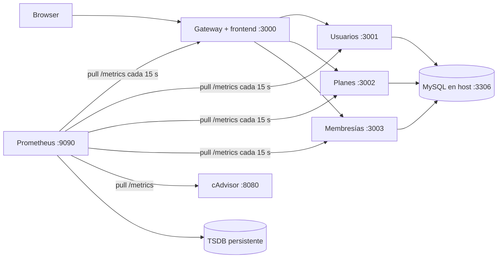

# FitLife

Aplicación de gestión de gimnasio construida con un frontend estático, un API
Gateway y tres microservicios Node.js/Express. Los servicios usan MySQL y JWT.

## Requisitos

- Node.js y npm
- MySQL en ejecución en `localhost:3306` (por ejemplo, desde XAMPP)
- Las bases de datos y tablas configuradas para usuarios, planes y membresías

## Configuración local en Windows

1. Inicia MySQL desde XAMPP.
2. En cada carpeta de servicio, crea `.env` copiando `.env.example` y completa
   las credenciales y nombres de bases de datos locales:
   - `gateway`
   - `usuarios-service`
   - `planes-service`
   - `membresias-service`
3. Instala dependencias si aún no están instaladas, ejecutando `npm install`
   dentro de cada una de esas cuatro carpetas.
4. Abre una terminal en cada carpeta y ejecuta:

   ```powershell
   node src\app.js
   ```

   Puertos predeterminados: gateway `3000`, usuarios `3001`, planes `3002` y
   membresías `3003`.
5. Abre <http://localhost:3000>.

El gateway sirve el frontend y reenvía las solicitudes `/api` a los
microservicios. Las funciones que consultan o modifican datos necesitan que
MySQL esté disponible y que las bases de datos estén creadas.

## Seguridad

No subas archivos `.env`: contienen credenciales locales y secretos. Git los
ignora; usa los archivos `.env.example` como plantilla y crea secretos propios
para cada entorno.

## DevOps y Monitoreo

### Ejecutar con Docker Compose

Requisitos: Docker Desktop con contenedores Linux y una instancia de MySQL
accesible desde Docker. Para usar MySQL de XAMPP, inicia MySQL y crea las bases
de datos/tablas requeridas por la aplicación antes de iniciar los contenedores.

En Windows, crea el archivo `.env` de la raíz copiando `.env.example` y define
un `JWT_SECRET` propio, `DB_USER`, `DB_PASSWORD` y tu `DOCKERHUB_USER`. No
compartas ni subas ese archivo. Luego, desde la raíz:

```powershell
docker compose up -d --build
```

La configuración predeterminada conecta los servicios a MySQL del host mediante
`host.docker.internal:3306`. Si esa conexión no funciona, el perfil opcional de
MySQL crea las tres bases de datos; para usarlo, establece `DB_HOST=db` en el
`.env` de la raíz y ejecuta:

```powershell
docker compose --profile db up -d --build
```

El perfil alternativo crea las bases de datos, pero no sustituye la carga de
tablas ni de datos iniciales que necesite tu instalación. Los cambios de
configuración se aplican al recrear los servicios con `docker compose up -d`.

| Componente | Dirección local |
| --- | --- |
| Aplicación FitLife (gateway + frontend) | <http://localhost:3000> |
| Prometheus | <http://localhost:9090> |
| cAdvisor | <http://localhost:8080> |
| Servicio de usuarios | <http://localhost:3001> |
| Servicio de planes | <http://localhost:3002> |
| Servicio de membresías | <http://localhost:3003> |

Compose publica estos puertos solo en la interfaz local (`127.0.0.1`), no en
otras interfaces de red del equipo.

En Prometheus, abre **Status → Targets** y comprueba que los jobs `gateway`,
`usuarios`, `planes`, `membresias`, `prometheus` y `cadvisor` aparezcan como
`UP`. Las métricas se pueden consultar en la pestaña **Graph**; hay ejemplos
en [`monitoring/QUERIES.md`](monitoring/QUERIES.md).

Consultas PromQL para la demostración:

```promql
rate(process_cpu_seconds_total[1m]) * 100
process_resident_memory_bytes / 1024 / 1024
sum by (job) (rate(http_requests_total[1m]))
up
sum by (id) (rate(container_cpu_usage_seconds_total{id!=""}[1m]))
container_memory_rss{id!=""} / 1024 / 1024
```

Los queries de cAdvisor agrupan por el identificador `id` que exporta el
recolector. En Docker Desktop para Windows pueden corresponder a grupos de la
VM Linux, no a nombres individuales de los contenedores FitLife.

### Prometheus: qué es y cómo monitorea

Prometheus es un sistema de monitoreo y alertas que almacena series de tiempo
identificadas por métricas y etiquetas. Su servidor consulta periódicamente los
endpoints de métricas (modelo **pull**) y guarda las muestras en su TSDB local.
En este proyecto el intervalo es de 15 segundos: Prometheus recolecta
`/metrics` en cada proceso Node.js y cAdvisor expone métricas de los
contenedores. El endpoint de aplicación proporciona las métricas por defecto
de proceso del cliente Prometheus y el contador `http_requests_total`, con
etiquetas `method`, `route` y `status`.

La arquitectura incluye el servidor Prometheus y su TSDB, los endpoints
instrumentados de los servicios, cAdvisor como recolector/exporter de
contenedores y PromQL para consultar los datos. **Alertmanager** es el
componente de Prometheus que agrupa y enruta alertas; no está desplegado en este
Compose. La lista de objetivos se revisa en **Status → Targets**.

`process_cpu_seconds_total` acumula CPU consumida por el proceso Node.js y
`process_resident_memory_bytes` mide su memoria residente (RAM) en bytes.
PromQL puede convertir la primera a una tasa y la segunda a MiB. cAdvisor
complementa estos datos con CPU y memoria por contenedor; son medidas distintas
del consumo total del host.

### CI/CD y publicación de imágenes

El workflow [`.github/workflows/ci.yml`](.github/workflows/ci.yml) se ejecuta en
cada push a `main`. Para cada uno de los cuatro servicios instala dependencias
con `npm ci`, ejecuta `npm test`, construye la imagen y la publica en Docker Hub
con las etiquetas `latest` y `sha-<commit-corto>`. En el repositorio de GitHub
configura estos Actions secrets:

- `DOCKERHUB_USERNAME`: usuario de Docker Hub.
- `DOCKERHUB_TOKEN`: token de acceso de Docker Hub (no la contraseña de la
  cuenta).

El push a GitHub y la publicación a Docker Hub se realizan desde el workflow;
requieren que exista un repositorio remoto y que esos secrets estén
configurados.

### Arquitectura



El gateway enruta las peticiones del frontend hacia los microservicios. Cada
servicio publica `/health` y `/metrics`; `/health` y `/metrics` del gateway son
públicos y no requieren JWT.

### Comandos útiles

```powershell
docker compose ps
docker compose logs -f
docker compose down
```

Para publicar manualmente una imagen después de construirla, inicia sesión con
`docker login`, etiqueta la imagen con tu usuario y ejecuta `docker push`. No
guardes credenciales de Docker Hub en el repositorio.
